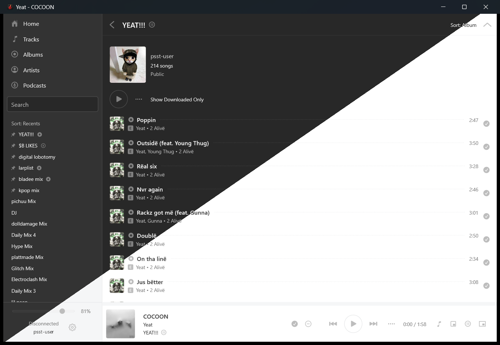

# Psst (Windows fork)

A personal fork of [Psst](https://github.com/jpochyla/psst), the fast Spotify client with a native GUI written in Rust, without Electron.
This fork only targets **Windows**, and adds offline downloads, a queue, Discord and Last.fm integration, lyrics and many fixes for daily use.

**Note:** A Spotify Premium account is required.

> **ℹ️ Since February 2026, Spotify [requires your own Developer Client ID](https://developer.spotify.com/blog/2026-02-06-update-on-developer-access-and-platform-security) for Web API features.** Register an app at the [Spotify Developer Dashboard](https://developer.spotify.com/dashboard) (redirect URI: `http://127.0.0.1:8888/login`, with the Web API enabled), then enter its Client ID on Psst's sign-in screen.



## Features

### Library

- **All your liked songs**, thousands of them, read like the web player does, so the Web API's rate limits don't get in the way.
- **Artists** page with the artists you follow, as a list or a grid; each opens the songs you saved from them.
- **Sorting** that each list keeps on its own (every playlist, Liked Songs, every artist), and the sidebar's playlists sorted like Spotify's library: Recents, Recently Added, Alphabetical, Creator or Custom Order.
- **Genre search** through Last.fm tags, which finds niche genres that Spotify's own search misses.
- **Select songs** with Ctrl+click and Shift+click to like or download them at once, or like every song of a playlist or album.
- Albums as a grid of covers, local files inside playlists.

### Playback

- **Queue** next to the page: what plays next, to reorder or remove, and what already played.
- **Picks up where you left off**, paused, when Psst starts again.
- **Hide songs** for 30 days or for good, like Spotify's "hide".
- The playing song is highlighted only in the list it plays from, which follows it.
- **Synced lyrics** (from Spotify, or [LRCLIB](https://lrclib.net) when Spotify has none), on their own page or in a small floating panel.
- Media keys and the Windows media overlay.

### Offline

- **Download** playlists, albums, an artist's saved songs or any selection for offline listening. Stop a download at any time.
- Downloads are kept apart from the cache of what you play, which stays under 5 GB. Both stay encrypted, as Spotify sends them.
- Marks for downloaded songs, playlists and artists, and a "Show Downloaded Only" switch on playlists.
- Your playlists and liked songs still show without a connection.

### Integrations

- **Discord Rich Presence** with your own Discord app: shows the song and the artist, and nothing while paused.
- **Last.fm** scrobbling, with the track's length.

### Everyday use

- Survives flaky connections: requests are retried, and errors have a **Retry** button.
- Follows Windows' light or dark mode.
- Keyboard shortcuts: Ctrl+F finds in the open list, Ctrl+L goes to the search box, Ctrl+1–5 open the sidebar pages, Ctrl+R reloads the page, space plays or pauses.

## Building

There are no prebuilt releases: build it on Windows with the latest stable [Rust](https://rustup.rs/).

```shell
cargo build --release
```

The app is then `target\release\psst-gui.exe`. Close Psst before building, or Windows won't let the new file replace it.

Before pushing, run the same checks the project used to run on CI:

```shell
cargo clippy --all-targets -- -D warnings
cargo test
```

## Project structure

- `/psst-core` - Spotify session, audio file retrieval, decoding, audio output, playback queue, downloads, Last.fm.
- `/psst-gui` - The app, built with [Druid](https://github.com/linebender/druid).

## Privacy

Psst doesn't call home. Besides Spotify's own servers, it only talks to:

- [LRCLIB](https://lrclib.net), for lyrics Spotify doesn't have.
- [ip-api.com](https://ip-api.com), for your region and time zone, which Spotify's Home sections need. Nothing about your account is sent.
- [Last.fm](https://www.last.fm), only when you connect it, for scrobbles and genre search.
- Discord, on your computer, only when Rich Presence is on.

Your password is not stored: Psst keeps a reusable login token from Spotify. Settings live in `%APPDATA%\Psst`, and the cache and downloads in `%LOCALAPPDATA%\Psst`, which you can clear from Preferences.

## Thanks

This fork stands on [Psst](https://github.com/jpochyla/psst) by Jan Pochyla and its contributors, and Psst wouldn't exist without:

- [`librespot`](https://github.com/librespot-org/librespot), the Open Source Spotify client library for Rust, which inspired most of `psst-core`.
- [`druid`](https://github.com/linebender/druid), the native GUI library for Rust.
- [`ncspot`](https://github.com/hrkfdn/ncspot), the ncurses Spotify client written in Rust.
- ...and the other libraries and projects it uses.
